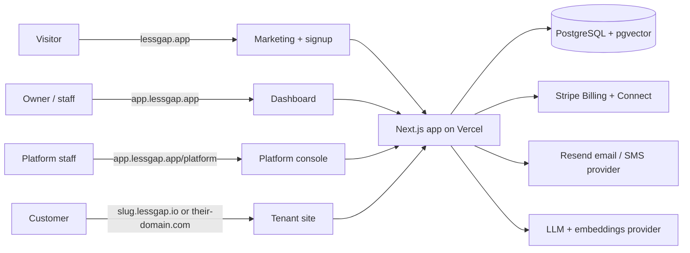

# Architecture

**Status:** `draft`

## One deployment, three surfaces



All four surfaces are the same Next.js application. `src/proxy.ts` decides
which one a request belongs to, from the hostname, and rewrites it to an
internal route. Nothing else in the app reads the hostname.

| Hostname | Surface | Internal route |
| --- | --- | --- |
| `lessgap.app`, `www.lessgap.app` (redirects to apex) | Marketing | `src/app/[locale]/(public)` (existing) |
| `app.lessgap.app` | Dashboard, platform console, auth | `src/app/(dashboard)`, `src/app/(platform)`, `src/app/(auth)` |
| `<slug>.lessgap.io` | Tenant site | rewritten to `src/app/sites/[host]/...` |
| any verified custom domain | Tenant site | rewritten to `src/app/sites/[host]/...` |
| anything else | 404 | — |

The rewrite target carries the hostname, not the tenant id. The site layout
resolves the host to a tenant with `getSiteByHost(host)` (cached), so a
tampered path cannot select another tenant. Direct requests to `/sites/...`
on any host are refused by the proxy.

## Layers

```
app route (page, layout, route handler, server action)
  → module service  (src/modules/<module>/server/*)      business rules, entitlement checks
    → tenant data access (tenantDb(ctx))                  tenant-scoped Prisma
      → PostgreSQL (RLS as a second line, see tenancy)
```

- A route never queries Prisma directly for tenant data. It calls a module service.
- A service takes a `TenantContext` as its first argument. It never reads the
  session itself, so it can be called from a job, a webhook or a test.
- Pure rules (prices, availability, fee calculation, limits) are functions in
  `src/modules/<module>/lib/` with tests in `tests/unit/modules/<module>/lib/`, as the kit already does for `src/lib`.

## Where code lives

Code inherited from the kit stays where it is unless a phase brief moves it.
Platform code goes into its own directories so module boundaries stay clear
([ADR 0011](./adr/0011-independent-project-kit-as-reference.md)).

```
src/
  platform/                 cross-cutting platform core
    tenancy/                TenantContext, tenantDb, host resolution, membership
    entitlements/           registry of features and limits, resolve, require, usage
    switches/               platform switches
    domains/                Vercel domain API wrapper, verification
    audit/                  audit log writer
    jobs/                   background job runner and schedules
  modules/<module>/         one folder per business module (see below)
  themes/<themeKey>/        one folder per theme (see sites-themes-verticals)
  verticals/<verticalKey>.ts  one preset per industry
  app/
    (platform)/platform/    platform console
    (dashboard)/t/[slug]/   tenant dashboard
    sites/[host]/           tenant site, only reached by proxy rewrite
```

### Module folder shape

Every module has the same shape, created by `pnpm new:module`. A module that
needs less leaves folders out; it never invents new ones. The manifest,
lifecycle, stages and extension points are specified in
[module-system.md](./15-module-system.md).

```
src/modules/booking/
  module.ts            manifest: features, permissions, settings, models, nav, site blocks,
                       events, jobs, extension points, lifecycle, dependencies, stage
  events.ts            typed, versioned payloads of the events this module emits
  schema.ts            Zod schemas shared by forms and services
  lib/                 pure functions + *.test.ts
  server/              services ("server-only"), each takes TenantContext first
  actions.ts           "use server" actions: auth → context → parse → service → revalidate
  components/          dashboard UI for this module
  site/                building blocks themes use to render this module publicly
  jobs.ts              scheduled or queued work, if any
```

A module may import from `src/platform/*`, from kit code and from another
module's `server/` **public index only** (`src/modules/<other>/server/index.ts`).
It never imports another module's components or internals. The module
registry (`src/modules/registry.ts`) is the only list of modules.

## Technology choices

| Concern | Choice | Why | ADR |
| --- | --- | --- | --- |
| App | Next.js 16 App Router, React 19 | What the kit is | — |
| Auth | Better Auth with the organization plugin | Already in the kit; organizations, members, roles, invitations | [0003](./adr/0003-better-auth-organizations-for-tenants.md) |
| Database | PostgreSQL (Neon), Prisma 7 | Already in the kit; branching for previews | — |
| Isolation | Shared tables with `tenantId`, scoped client, Postgres RLS | Lowest cost per tenant, proven in platform.madelab.io | [0002](./adr/0002-shared-database-tenant-id-and-rls.md) |
| Hosting, domains | Vercel for Platforms | Wildcard subdomains, custom domains with automatic SSL, domain API | [0004](./adr/0004-vercel-for-subdomains-and-custom-domains.md) |
| Themes | React components in the repo, registry by key | Designers already work in code; type-checked; no runtime HTML | [0005](./adr/0005-themes-are-code.md) |
| Tenant payments | Stripe Connect | Tenants get paid directly, we take an application fee | [0006](./adr/0006-stripe-connect-for-tenant-payments.md) |
| Chatbot retrieval | pgvector in the same database | One database, tenant filter and RLS apply to embeddings too | [0007](./adr/0007-pgvector-for-rag.md) |
| Background work | Vercel Cron + a jobs table processed by a cron route | No new infrastructure until volume needs it | [0008](./adr/0008-jobs-table-before-a-queue.md) |
| Capabilities | Modules as plugins on a kernel, with manifest, lifecycle and stages | Switch on/off and experiment per tenant without code changes | [0010](./adr/0010-modules-are-plugins-with-a-kernel.md) |
| Email | Brevo now, Amazon SES later, behind `sendEmail()` | Already used by the company; Resend kept as kit fallback | [0009](./adr/0009-brevo-for-email-ses-later.md) |
| SMS | Twilio, behind an interface | Reminders; consent rules in compliance doc | — |
| Media, exports, backups | Cloudflare R2 (S3-compatible), tenant-prefixed keys | Zero egress; signed URLs; one wrapper | [0018](./adr/0018-cloudflare-r2-for-storage.md) |
| Error tracking | Sentry (free tier) + `ErrorReport` table | Alerts and source maps out; console page in | [0017](./adr/0017-sentry-for-error-tracking.md) |
| Rate limiting | in-memory, shared via Upstash REST when env-set | Speed bump now, real wall later, no rewrite | — |

## Caching

- Tenant site pages are cached per host and revalidated by tag when the tenant
  saves content: `revalidateTag(siteTag(tenantId))`. A save in the dashboard
  shows on the site within seconds without a deploy.
- Host → tenant resolution is cached and invalidated when a domain changes.
- Entitlements are cached per tenant and invalidated on plan change, override
  change or switch change.
- Never cache anything per customer in a shared cache key.
